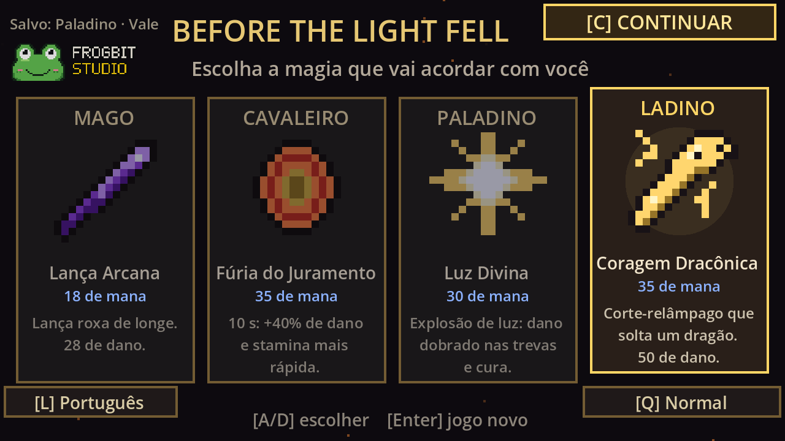
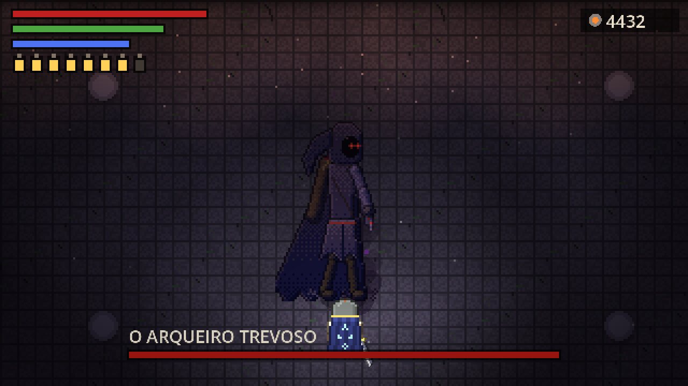
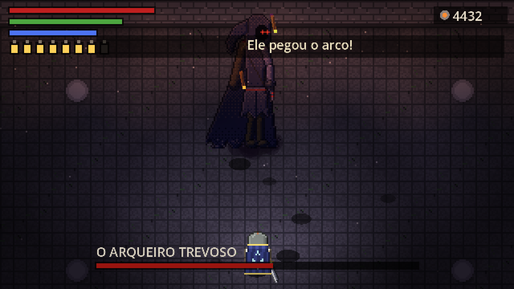
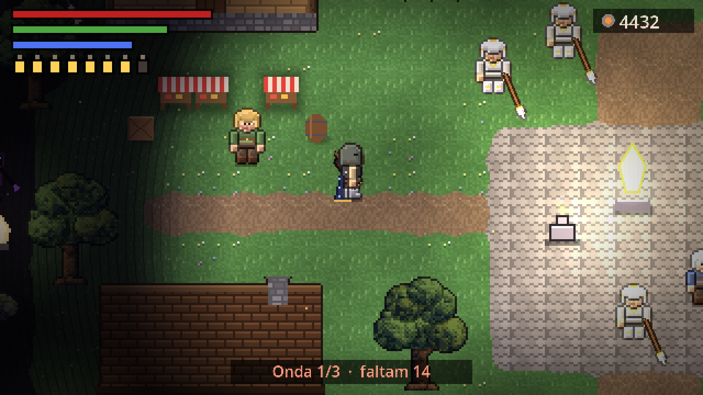
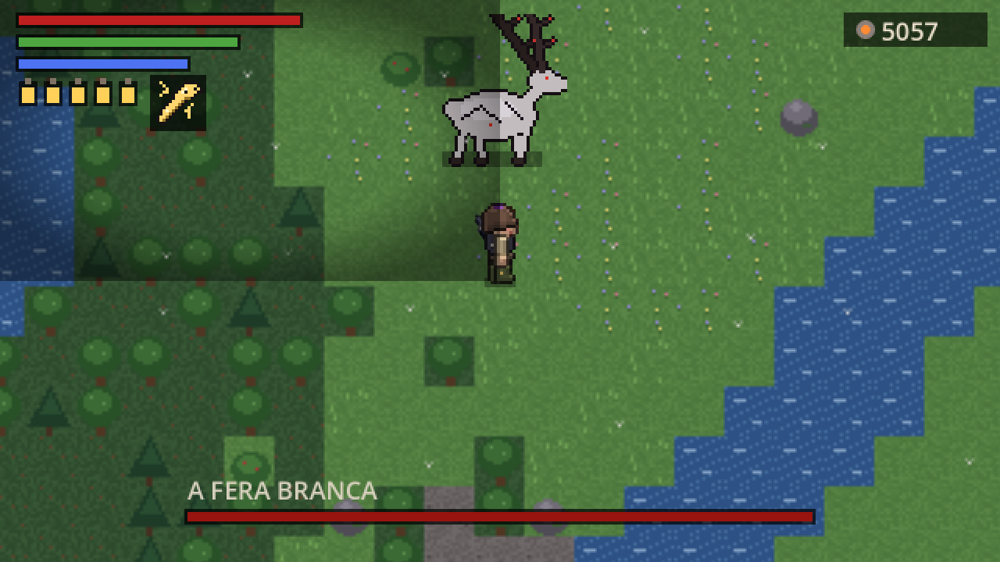

# ✦ BEFORE THE LIGHT FELL

**A dark fantasy pixel action RPG by Frogbit Studio.**

You wake up on the cold floor of a church, with a sword you don't remember and a paper written in a language no one can read.
Outside, the world is ashes. Only one village is still alive, inside a circle of Light: **Trakaya**.
How long will the Light last?

> **Version 1.0** · Windows · English, Português, Español

## What's inside

- A hard, real-time action RPG (stamina, dash, charged attacks, parries), with **3 difficulties**: Normal, Hard and Nightmare.
- Create your hero: pick your first spell and split **50 status points** (yes, some stats *must* stay low).
- Swords, two-handed weapons, small off-hand blades that make enemies **bleed**, bows, spells, mastery.
- A village to help, a valley to explore, **8 dungeons**: a wolf den with a giant you must hide from, a sunken temple where silence keeps you alive, mines, a crypt between the living and the dead...
- Field bosses, hunts, wanted posters, hidden secrets, runestones.
- Original music.
- And something that happens **after** the end. 🌀

## How to download and play

1. Go to **[Releases](../../releases/latest)** and download **BeforeTheLightFell-v1.0-Windows.zip**.
2. Right-click the zip → **Extract All**. Don't open the game from inside the zip!
3. Open the folder and double-click **Before the Light Fell.exe**.
4. If Windows says "Windows protected your PC": **More info → Run anyway**. It's a homemade game, not a virus.

## Controls

| Key | Action |
|---|---|
| W A S D | Move · Shift: run |
| J | Attack (hold: charged attack) |
| K / right mouse | Off-hand weapon (dagger or bow) |
| Space | Dash (invincible for a moment) |
| F · Q | Cast spell · next spell |
| R | Healing flask |
| E | Interact / read / open |
| I or Tab | Inventory |
| M | Map (in the Valley) |
| T | Agile Focus (once you learn it) |
| V | ...you'll find out 🐺 |

On the title screen: **L** changes the language, **Q** changes the difficulty.

---

## Português

**Um RPG de ação em pixel art, de fantasia sombria, feito pela Frogbit Studio.**

Você acorda no chão frio de uma igreja, com uma espada que não lembra de onde veio e um papel escrito numa língua que ninguém sabe ler.
Lá fora, o mundo é cinza. Só uma vila continua viva, dentro de um círculo de Luz: **Trakaya**.
Até quando a Luz vai durar?

**Como jogar:** baixe o **BeforeTheLightFell-v1.0-Windows.zip** em [Releases](../../releases/latest), clique com o botão direito → **Extrair tudo**, e abra o **Before the Light Fell.exe**. Se aparecer "O Windows protegeu o computador": **Mais informações → Executar assim mesmo**.

Na tela inicial: **L** troca o idioma (português, inglês, espanhol) e **Q** troca a dificuldade (Normal, Difícil, Pesadelo).

---

Made with ❤️ by **Frogbit Studio** · Godot 4.
